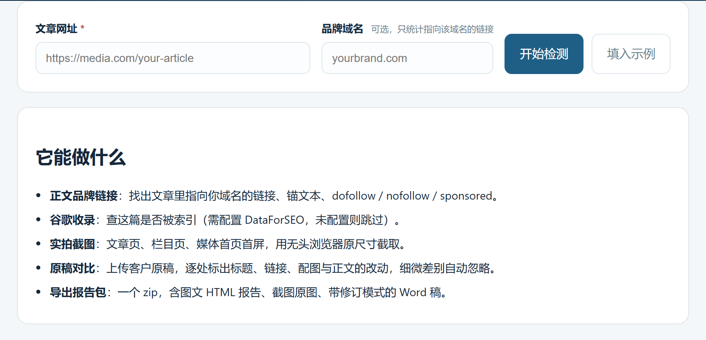

# Article Link Checker

Paste the URL of an overseas media placement and see five things at once: **the brand links and anchor text in the body, whether Google has indexed it, whether the outlet's homepage links to it, what the page actually looks like, and how the published version differs from your draft**. Then export a zip with an illustrated HTML report, full-size screenshots and a Word redline.

Built for people who have to prove a placement actually ran — and for the clients who ask.



> 中文说明见 [README.md](README.md)
>
> Hosted demo (no install): <https://www.youtupr.com/tools/article-link-checker>

## What it is for

After a placement goes live, three questions always come back: is the link there? did it really run? is it the same as the draft I approved?

Doing that by hand means screenshots, copy-pasted URLs and a hand-written comparison table. This tool automates the whole loop.

## Features

| Feature | Detail |
|---|---|
| Brand link audit | Detects the brand's own outbound links automatically (anchor text + landing-path scoring), with `dofollow` / `nofollow` / `sponsored` / `ugc`; a domain can also be specified manually |
| Google indexing | Whether the article is indexed and where it ranks (optional, needs DataForSEO) |
| Live screenshots | Article page, section page, outlet homepage — 1500×1000 JPEG |
| Draft comparison | Upload `.docx` / `.pdf` / `.md` / `.txt` / `.html`; title, anchors, links, images and body text are diffed, while punctuation and synonym-level rewording are ignored |
| Export | One zip: illustrated HTML report (screenshots embedded, works offline) + original screenshots (≥100 KB each) + a Word file with tracked changes (`w:ins` / `w:del`) |

## Quick start

```bash
git clone https://github.com/gongzhm/article-link-checker.git
cd article-link-checker

npm install                       # also installs Chrome for Testing
# if the browser download was skipped:
npx puppeteer browsers install chrome-headless-shell

cp .env.example .env              # optional, defaults work
npm start                         # http://127.0.0.1:3003
```

Open `http://127.0.0.1:3003`, paste an article URL.

Requires Node.js ≥ 22 (uses the built-in `--env-file-if-exists`).

## Configuration

Everything is environment-driven — see `.env.example`.

| Variable | Default | Purpose |
|---|---|---|
| `PORT` / `HOST` | `3003` / `127.0.0.1` | Listen address. Use `HOST=0.0.0.0` behind a reverse proxy when self-hosting |
| `DATA_DIR` | `./data` | Screenshots, Chrome profile, image-signature cache |
| `ALLOWED_ORIGINS` | empty | Comma-separated origins allowed to call the API. Empty means no check (local / intranet) |
| `DATAFORSEO_AUTH` | empty | Google indexing and SERP screenshots. When empty these two features are skipped |
| `USER_AGENT` | `ArticleLinkChecker/1.0` | UA used when fetching target pages |
| `REPORT_AUTHOR` | `Article Link Checker` | Author shown on tracked changes in the Word file |

## API

```
POST /api/article-check        { "url": "...", "targetDomain": "yourbrand.com" }
GET  /api/article-check?job=   poll until pending=false
POST /api/article-compare      { "url": "...", "file": { "name": "draft.docx", "data": "<base64>" } }
GET  /api/article-compare?job= poll the comparison
POST /api/article-report       { html, meta, comparison, shots } → zip
GET  /api/article-shot/<name>  screenshot file
GET  /health
```

Checks are asynchronous: POST returns a `jobId`, the page polls about once a second. A full run usually takes 20–40 seconds.

## How it works

- Fetches source HTML over plain HTTP without executing the outlet's scripts (except while taking screenshots): fast, and less likely to trip anti-bot defences.
- Body extraction uses cheerio, picking the article container by paragraph density and tag structure.
- Screenshots run through Puppeteer with `chrome-headless-shell`: three captures in series, 12 s timeout each, article body first so the most important shot always lands.
- Draft comparison splits both texts into sentences, pairs them by similarity, then separates substantive edits from wording tweaks by checking whether content words changed. Wholesale deletions/additions are rolled up into one line instead of one row per paragraph.
- The Word file is a hand-built minimal OOXML package: `w:ins` / `w:del` for edits, `<w:trackChanges/>` in `settings.xml`.

## Known limits

- Some outlets sit behind Cloudflare or a login wall. When the body cannot be read the tool returns what it can — it never fabricates data.
- The homepage check only asks whether a link to the article path exists on the homepage; dynamically injected recommendation widgets may be missed.
- Draft comparison is heuristic. For heavy rewrites the output is coarse and needs a human pass.
- Google features depend on a third-party API. Without it those two panels report "unavailable"; everything else still works.

## Fair use

- Only check pages you are entitled to access and need for your own business verification. Respect the target site's `robots.txt` and terms.
- The tool browses as a normal browser but may still be rate-limited; it self-limits to 6 requests per minute per IP.
- Reports are for internal and client communication, not a statement of fact about any outlet or editor.

## License

MIT
