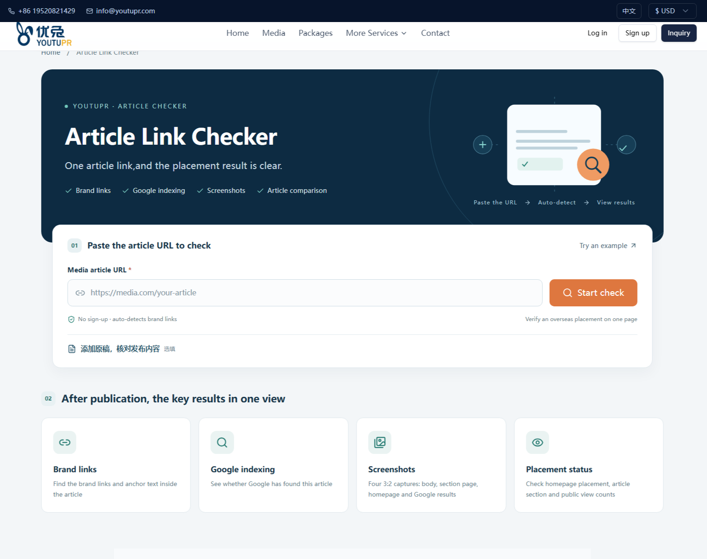
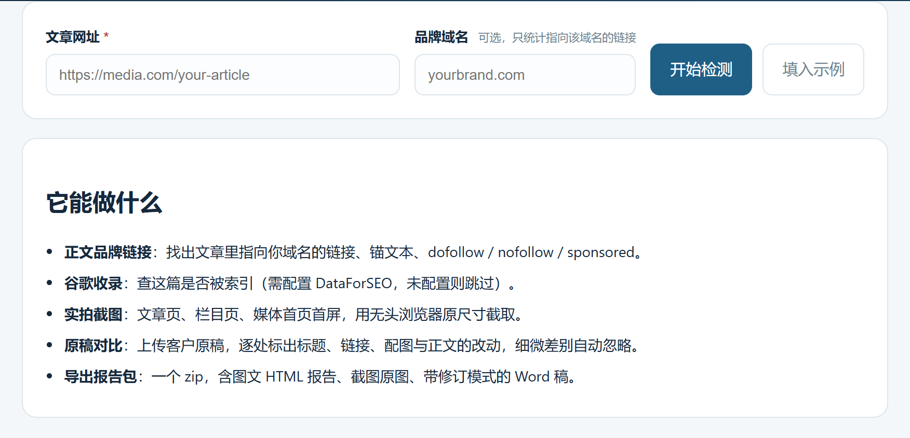

# Article Link Checker



<sub>上图是在线托管版（<https://www.youtupr.com/tools/article-link-checker>，英文界面、带品牌样式）的截图；本地部署后功能一致、界面更简洁，见下方「快速开始」。</sub>

粘贴一篇海外媒体文章的网址，一次看清五件事：**正文里的品牌链接与锚文本、有没有被谷歌收录、媒体首页有没有入口、页面实际长什么样、发布版和你的原稿差在哪**。最后导出一个压缩包：图文报告 + 截图原图 + 带修订模式的 Word。

给自己用，也给客户看。适合做海外 PR / 发稿 / 内容投放的人核对交付结果。

> English: see [README.en.md](README.en.md)

## 它解决什么问题

发完稿，客户会问三个问题：链接带了吗？真的发出去了吗？和我给的原稿一样吗？

以前的做法是逐张截图、复制链接、手写对比表。这个工具把这一套自动化：抓正文、提链接、查收录、拍三张屏、跟原稿逐处比对，最后生成一份可以直接转发的报告。

## 功能

| 功能 | 说明 |
|---|---|
| 品牌链接核查 | 自动识别正文里属于品牌方的外链（按锚文本、落地页路径打分），给出锚文本与 `dofollow` / `nofollow` / `sponsored` / `ugc`；也可手动指定域名 |
| 谷歌收录 | 查这篇文章是否被索引、搜索结果里排第几（需配置 DataForSEO，可选） |
| 实拍截图 | 文章页 / 频道栏目页 / 媒体首页首屏，1500×1000 JPEG |
| 原稿对比 | 上传 `.docx` / `.pdf` / `.md` / `.txt` / `.html`，逐处比对标题、锚文本、链接、配图、正文；标点与同义措辞等细微差异自动忽略 |
| 报告导出 | 一个 zip：图文 HTML（截图内嵌，离线可看）+ 截图原图（≥100KB）+ Word 修订稿（`w:ins` / `w:del`，可在「审阅」里接受或拒绝） |

## 快速开始

```bash
git clone https://github.com/gongzhm/article-link-checker.git
cd article-link-checker

npm install                       # 会一并安装 Chrome for Testing
# 如果跳过了浏览器下载：
npx puppeteer browsers install chrome-headless-shell

cp .env.example .env              # 可选，默认配置就能跑
npm start                         # http://127.0.0.1:3003
```

打开 `http://127.0.0.1:3003`，粘贴文章网址即可。



要求 Node.js ≥ 22（用到内置的 `--env-file-if-exists`）。

## 配置

全部通过环境变量，见 `.env.example`。

| 变量 | 默认 | 说明 |
|---|---|---|
| `PORT` / `HOST` | `3003` / `127.0.0.1` | 监听地址。放到服务器上时改 `HOST=0.0.0.0` 并在前面套 Nginx |
| `DATA_DIR` | `./data` | 截图、Chrome 用户目录、图片指纹缓存的存放位置 |
| `ALLOWED_ORIGINS` | 空 | 允许调用接口的来源，逗号分隔。留空不校验（本机/内网） |
| `DATAFORSEO_AUTH` | 空 | 谷歌收录与搜索结果页截图。不填则这两项自动跳过，其余功能正常 |
| `USER_AGENT` | `ArticleLinkChecker/1.0` | 抓取目标站点时使用的 UA |
| `REPORT_AUTHOR` | `Article Link Checker` | Word 修订稿里显示的修订人 |

## 接口

服务同时提供网页和 HTTP 接口，都是 JSON：

```
POST /api/article-check        { "url": "...", "targetDomain": "yourbrand.com" }
GET  /api/article-check?job=   轮询检测进度，pending=false 即完成
POST /api/article-compare      { "url": "...", "file": { "name": "draft.docx", "data": "<base64>" } }
GET  /api/article-compare?job= 轮询对比进度
POST /api/article-report       { html, meta, comparison, shots } → zip
GET  /api/article-shot/<name>  截图文件
GET  /health
```

检测是异步的：POST 拿到 `jobId` 后每秒轮询，页面会自动更新，一般 20–40 秒出全部结果。

## 它是怎么工作的

- 只用 HTTP 抓源 HTML，不执行媒体页面上的脚本（除非截图环节），所以速度快、也避免被反爬挡。
- 正文抽取用 cheerio，按段落密度与标签结构判断哪一块是文章主体。
- 截图走 Puppeteer + `chrome-headless-shell`，三张串行、单张 12 秒超时，正文优先——保证最要紧的那张先落地。
- 原稿对比先按句切分、做相似度配对，再按「是否动了实词」区分实质修改与细微措辞；整段被删/被加的不逐条罗列，合并成一行统计。
- Word 修订稿是手写的最小 OOXML，`w:ins` / `w:del` 标改动，`settings.xml` 里打开 `<w:trackChanges/>`。

## 已知限制

- 部分媒体有 Cloudflare 或登录墙，抓不到正文时只会返回可获取的部分，不会硬编数据。
- 首页「有没有本文入口」只判断首页里是否存在指向本文路径的链接；动态加载的推荐位可能抓不到。
- 原稿对比是启发式配对，长文改写比例很高时，结果偏粗，需要人工复核。
- 谷歌收录依赖第三方接口，未配置时状态显示为「不可用」，不影响其他功能。

## 合规与免责

- 请只检测你有权访问、且用于自身业务核对的页面。遵守目标站点的 `robots.txt` 与服务条款。
- 工具会以普通浏览器身份访问页面，但仍可能被站点限流，请控制频率（内置 6 次/分钟）。
- 报告用于内部与客户沟通，不构成对媒体、编辑或第三方的事实认定。

## License

MIT
